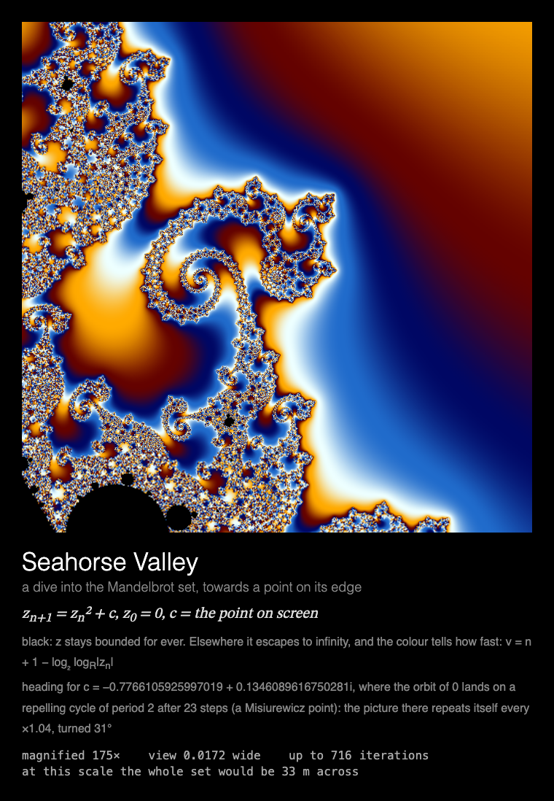

# MMM-FractalZoom

A [MagicMirror²](https://magicmirror.builders/) module that dives endlessly into the Mandelbrot set and Julia sets, drawn for a Raspberry Pi without a GPU.



## What you see

**Infinite zoom.** A dive into the Mandelbrot set or a Julia set, doubling the magnification
every 2 s towards a point on its edge, with new detail at every scale, until 64-bit arithmetic
runs out at about 10¹⁰×. Five dives, taking turns, one per showing: Seahorse Valley, Elephant
Valley, a Julia set's spiral, a three-armed star and the north bulb's filigree.

Under the picture: the equation, the point the dive is heading for and how the picture repeats
there, and live numbers: the magnification, the width of the view, the iteration limit, and how
big the whole set would be drawn at this scale on the screen (at 175×, 33 m across; by the end of
a dive, eight times the distance to the Moon).

Built for a **Raspberry Pi 3 without GPU acceleration**: everything is drawn by the CPU, the
keyframes are rendered by web workers on the Pi's other cores, and the animation stops while
the module is hidden (see [Performance](#performance)).

## Installation

```bash
cd ~/MagicMirror/modules
git clone https://github.com/charleswest775/MMM-FractalZoom
```

No npm dependencies: there is nothing to install.

## Update

```bash
cd ~/MagicMirror/modules/MMM-FractalZoom
git pull
```

## Configuration

```js
{
	module: "MMM-FractalZoom",
	position: "middle_center",
	config: {
		cycleSeconds: 600,  // longer than the page is shown: a new dive each time it comes round
		width: 700,
		height: 700,
		fps: 12,
		zoomWorkers: 2
	}
},
```

| Option | Default | Description |
|---|---|---|
| `zoomTargets` | `[]` | Which dives, e.g. `["seahorse", "elephant"]`. Empty = all five: `seahorse`, `julia-spiral`, `elephant`, `star`, `north` |
| `zoomSeconds` | `2` | Seconds per doubling of the magnification, at most. The zoom slows down when keyframes can't keep up |
| `zoomWorkers` | `2` | How many of the Pi's four cores render keyframes |
| `cycleSeconds` | `600` | Start a new dive this often; a new one also starts each time the module is shown again |
| `width`, `height` | `700` | Canvas size in pixels |
| `fps` | `12` | Frame-rate cap |
| `showMath` | `true` | Equations and live numbers under the canvas |
| `turns` | `null` | Take turns with other modules on the same page, e.g. `{ of: 2, at: 0 }` (see [Taking turns](#taking-turns)) |
| `statsPanel` | `false` | A line under the math showing what the mirror spends: fps, CPU of Electron and the compositor, a bar per core, temperature. Sampled by the module's `node_helper` from `/proc`, only while the module is shown |
| `debugStats` | `false` | Show achieved fps and per-frame timings in the corner of the screen |

## Taking turns

With `turns: { of: n, at: k }`, modules on the same [MMM-pages](https://github.com/edward-shen/MMM-pages)
page each show on their own one in n showings of it: `at: 0` on the first showing and every
nth after it, `at: 1` on the second, and so on. A module that isn't on its turn takes no room on the page and
costs nothing: it hides its canvas and doesn't start. So one slot in the rotation can hold
several pages, without making the rotation longer. For example, the zoom and
[MMM-Chladni](https://github.com/charleswest775/MMM-Chladni)'s sand figures, one per showing:

```js
{
	module: "MMM-FractalZoom",
	classes: "page-fractal",
	position: "middle_center",
	config: { turns: { of: 2, at: 0 } }
},
{
	module: "MMM-Chladni",
	classes: "page-fractal",
	position: "middle_center",
	config: { turns: { of: 2, at: 1 } }
},
{
	module: "MMM-pages",
	config: { modules: [["page-clock"], ["page-fractal"]], rotationTime: 30000 }
},
```

The zoom is the costliest page on a Pi; sharing its slot with the Chladni figures (about a third
of its cost) halves what the slot costs on average.

Without `turns` the module shows every time. It works just as well on a page of its own, or in
a normal region without MMM-pages, where it moves on to a new dive every `cycleSeconds`.

## What's real

Each dive heads for a point exactly on the fractal's edge, so there is detail at every scale:
a Misiurewicz point of the Mandelbrot set, where the orbit of 0 lands on a repelling cycle
(found to full precision by Newton's method, and checked by the tests), or the repelling fixed
point of a Julia set. Near such a point the picture repeats itself, magnified by the cycle's
multiplier |ρ| and turned by its angle, so the zoom could go on for ever; what stops it is
arithmetic. A double carries 53 bits, and at about 2³⁴ (10¹⁰×) neighbouring pixels would be
only a thousand units in the last place apart. There the dive ends and holds its last picture,
which costs nothing to show. Going deeper would take perturbation theory and arbitrary
precision, a different program.

Colour is the smooth escape time ν = n + 1 − log₂ (log |zₙ| / log R) on a cyclic gradient, in
log ν, so the bands stay about as wide at every depth while the escape times grow; black never
escapes. The iteration limit follows the escape times: twice what all but one pixel in a
thousand of the last keyframe needed.

## How it's drawn

Web workers (`zoomWorkers`, on other cores) render a keyframe of the canvas's size for every
doubling, a few ahead, each sharing out the rows. Each frame stretches one keyframe by up to 2×
and draws the next one in, sharp, over the middle, so the centre, where the eye is, never looks
enlarged. Keyframe times on the Pi, per core, 700×700: 0.3–1.5 s for Elephant Valley, the star
and the north bulb at any depth; 2–6 s for the Julia spiral; Seahorse Valley 1 s at 2⁶ rising to
12 s at 2³⁰ (it spirals so tightly, |ρ| = 1.04, that escape times keep growing). With two
workers the zoom keeps its 2 s per doubling for most of a 30 s showing, and slows down where it
can't. While it waits for a keyframe, and once the dive has ended, the module rests.

The workers are loaded from `simulations/zoom-worker.js`, so the page must be served over
http, as MagicMirror² does (a `file://` page can't start them). They are shut down when the dive
ends or the next one starts.

## Performance

Measured on a Raspberry Pi 3 B+ (Electron 42, software rendering), as CPU of the Electron
processes plus the `cage` compositor, in % of one core (the Pi has four); baseline mirror
without the module: 0.2%.

| | % of one core | achieved fps |
|---|---|---|
| module **hidden** (e.g. another MMM-pages page) | 0.3 | 0 |
| 700×700 at 12 fps, 2 workers, first 30 s of a dive: Elephant Valley, the star, the north bulb | 155–168 | 13 |
| the same, Seahorse Valley / the Julia spiral | 234 / 270 | 13 |

The drawing alone costs ~130% of a core at 12 fps: a stretched 700×700 image every frame. The
workers add ~25% each on the cheap dives and up to ~100% each on Seahorse Valley and the Julia
spiral. The Pi ran at 70–73 °C through the measurements. With the page hidden, the workers use
nothing.

Why it costs what it does, from micro-benchmarks on the Pi:

- There is no GPU acceleration to be had (the Pi 3's GPU only does GLES 2.0; Chromium needs
  3.0), so every pixel is drawn by the CPU.
- Any frame that changes the canvas costs ~2% of a core per fps, before drawing anything.
- On top of that, cost grows with the **area that changes**: Chromium redraws the bounding box
  of everything touched in a frame. A zoom changes every pixel of every frame, which is why it
  is the costliest page and is best kept to 700×700 at 12 fps. Pages that draw incrementally
  cost a fraction of it.
- JavaScript on the main thread is not the bottleneck; the keyframes' arithmetic is, and it
  runs in the workers, off the main thread.
- The frame loop sleeps with `setTimeout` until a frame is due. While it waits for a keyframe,
  or holds the dive's last picture, the module rests and is only polled twice a second. While
  MagicMirror² fades the module out, nothing new is drawn; once it is hidden, the loop stops.

## Development

```bash
node --test                  # escape times, targets, keyframe scheduling (no dependencies)
python3 -m http.server       # then open http://localhost:8000/dev/preview.html
```

`dev/preview.html` runs the module outside MagicMirror², in a portrait 1200×1920 frame, with
hide/show buttons that follow MagicMirror²'s suspend/resume order. Query options override the
config, e.g. `?target=seahorse` for one dive, or `?zoomWorkers=4&zoomSeconds=1`. It must be
served over http, for the workers.

The tests check escape times, that the cardioid and period-2 shortcut agrees with iterating,
that each Mandelbrot target is a Misiurewicz point of exactly its preperiod and period with a
repelling cycle and each Julia target a repelling fixed point, that the deepest view is still
varied and resolvable in 64 bits, that the colour gradient wraps round seamlessly, and that the
zoom never runs ahead of its keyframes and shuts its workers down at the end.

## License

MIT

Part of a family of MagicMirror² modules:
[MMM-ChaosTheory](https://github.com/charleswest775/MMM-ChaosTheory),
[MMM-Chladni](https://github.com/charleswest775/MMM-Chladni),
[MMM-Atom](https://github.com/charleswest775/MMM-Atom),
[MMM-SacredGeometry](https://github.com/charleswest775/MMM-SacredGeometry),
[MMM-Tilings](https://github.com/charleswest775/MMM-Tilings),
[MMM-PlanetsDance](https://github.com/charleswest775/MMM-PlanetsDance),
[MMM-SnowCrystal](https://github.com/charleswest775/MMM-SnowCrystal),
[MMM-NightSky](https://github.com/charleswest775/MMM-NightSky) and
[MMM-PhotoDeck](https://github.com/charleswest775/MMM-PhotoDeck).
